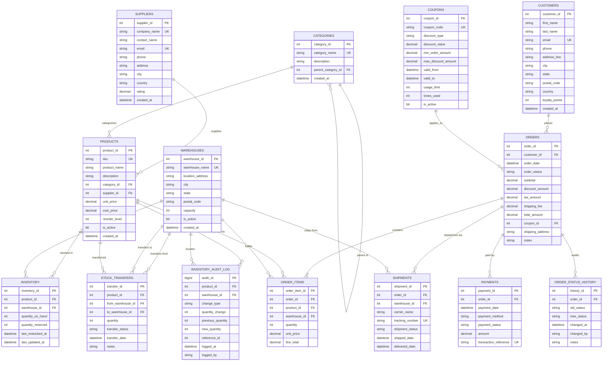

# Entity-Relationship (ER) Diagram & Relational Schema

This document details the conceptual, logical, and physical entity-relationship architecture for the **E-Commerce Inventory & Order Management System**.

---

## 1. Conceptual & Logical ER Diagram (Mermaid)

---

## 2. Cardinality & Multiplicity Analysis

| Relationship | Entities Involved | Cardinality | Explanation |
|---|---|---|---|
| Categorization | Categories (1) - Products (N) | `1:N` | One category contains zero or many products; each product belongs to one primary category. |
| Category Hierarchy | Categories (1) - Categories (N) | `1:N` (Self-referencing) | Sub-categories reference parent categories; allows arbitrary nested hierarchies. |
| Product Supply | Suppliers (1) - Products (N) | `1:N` | A supplier supplies many products; each product has a primary vendor supplier. |
| Warehouse Stocking | Products (M) - Warehouses (N) | `M:N` resolved by `Inventory` | A product is distributed across multiple regional fulfillment warehouses. |
| Customer Purchases | Customers (1) - Orders (N) | `1:N` | A customer places multiple orders over time. |
| Order Line Items | Orders (1) - Products (N) | `M:N` resolved by `Order_Items` | An order includes multiple items; each item specifies product, warehouse, and count. |
| Promotion Application | Coupons (0..1) - Orders (N) | `1:N` | An order can optionally have one valid coupon discount applied. |
| Payment Settlement | Orders (1) - Payments (1..N) | `1:N` | Orders have payment records (supports retries, splits, or refunds). |
| Logistics Fulfillment | Orders (1) - Shipments (1..N) | `1:N` | Orders may ship from different warehouses via carrier tracking numbers. |
| Order Audit Trail | Orders (1) - Order_Status_History (N) | `1:N` | Automatically records every status change over time. |
| Inventory Ledger | Products/Warehouses (1) - Inventory_Audit_Log (N) | `1:N` | Records every stock addition, deduction, transfer, or restore event. |

---

## 3. Relational Schema Representation

Underlined attributes denote **Primary Keys (PK)**; attributes marked with an asterisk `*` denote **Foreign Keys (FK)**.

1. **Suppliers** (<u>supplier_id</u>, company_name, contact_name, email, phone, address, city, country, rating, created_at)
2. **Categories** (<u>category_id</u>, category_name, description, *parent_category_id*, created_at)
3. **Products** (<u>product_id</u>, sku, product_name, description, *category_id*, *supplier_id*, unit_price, cost_price, reorder_level, is_active, created_at)
4. **Warehouses** (<u>warehouse_id</u>, warehouse_name, location_address, city, state, postal_code, capacity, is_active, created_at)
5. **Inventory** (<u>inventory_id</u>, *product_id*, *warehouse_id*, quantity_on_hand, quantity_reserved, last_restocked_at, last_updated_at)
6. **Stock_Transfers** (<u>transfer_id</u>, *product_id*, *from_warehouse_id*, *to_warehouse_id*, quantity, transfer_status, transfer_date, notes)
7. **Customers** (<u>customer_id</u>, first_name, last_name, email, phone, address_line, city, state, postal_code, country, loyalty_points, created_at)
8. **Coupons** (<u>coupon_id</u>, coupon_code, discount_type, discount_value, min_order_amount, max_discount_amount, valid_from, valid_to, usage_limit, times_used, is_active)
9. **Orders** (<u>order_id</u>, *customer_id*, order_date, order_status, subtotal, discount_amount, tax_amount, shipping_fee, total_amount, *coupon_id*, shipping_address, notes)
10. **Order_Items** (<u>order_item_id</u>, *order_id*, *product_id*, *warehouse_id*, quantity, unit_price, line_total)
11. **Payments** (<u>payment_id</u>, *order_id*, payment_date, payment_method, payment_status, amount, transaction_reference)
12. **Shipments** (<u>shipment_id</u>, *order_id*, *warehouse_id*, carrier_name, tracking_number, shipment_status, shipped_date, delivered_date)
13. **Order_Status_History** (<u>history_id</u>, *order_id*, old_status, new_status, changed_at, changed_by, notes)
14. **Inventory_Audit_Log** (<u>audit_id</u>, *product_id*, *warehouse_id*, change_type, quantity_change, previous_quantity, new_quantity, reference_id, logged_at, logged_by)

